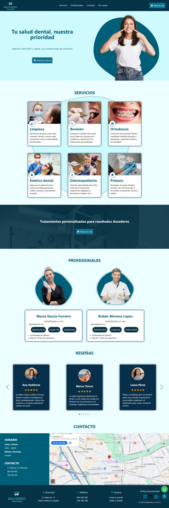
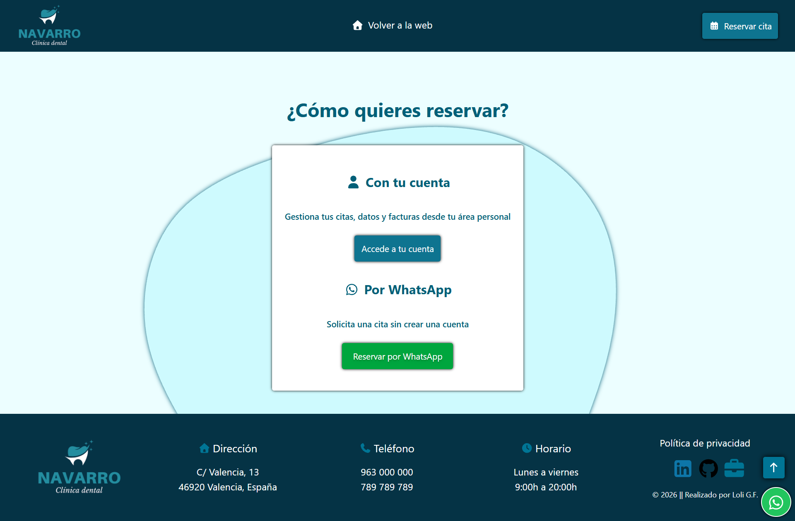
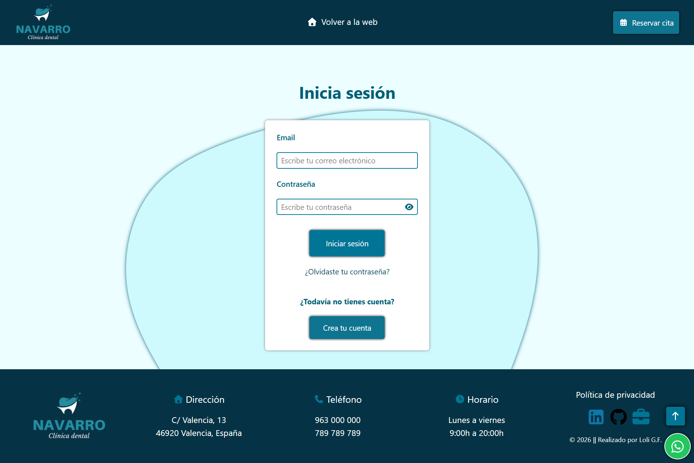
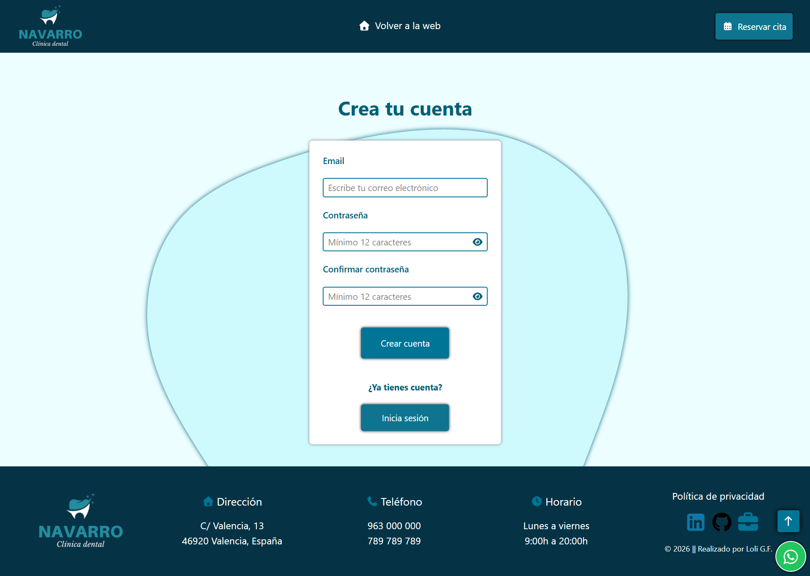
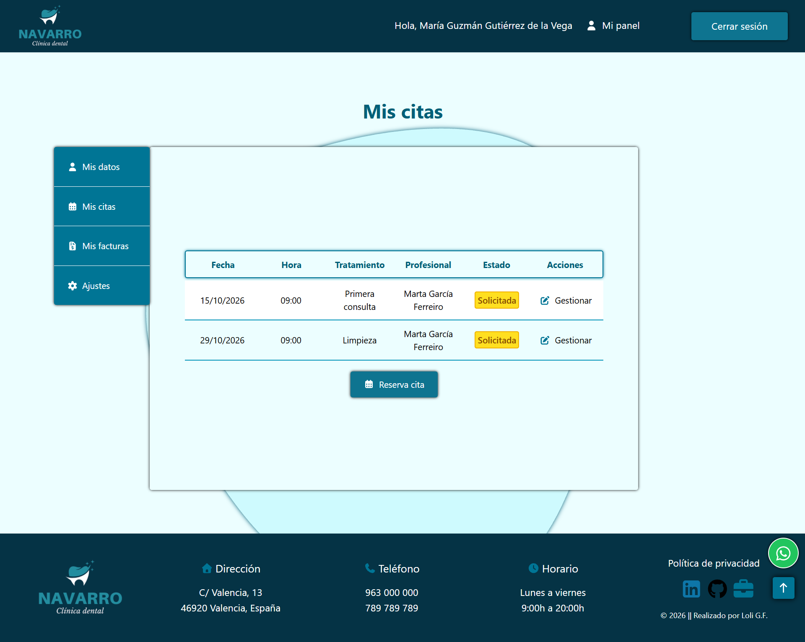
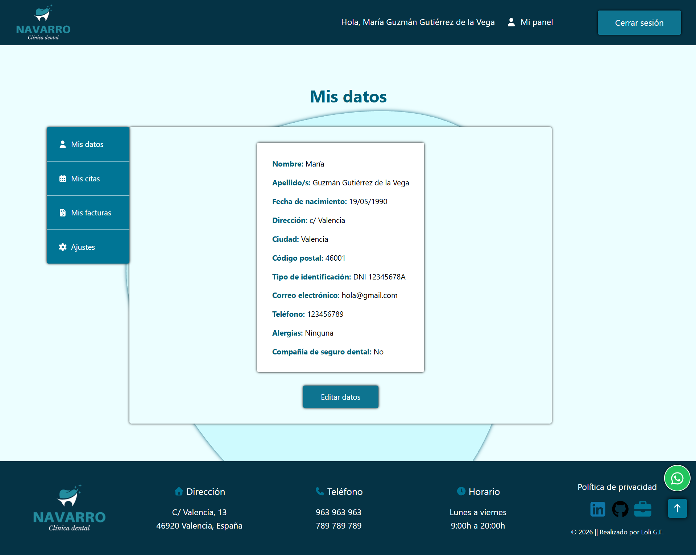
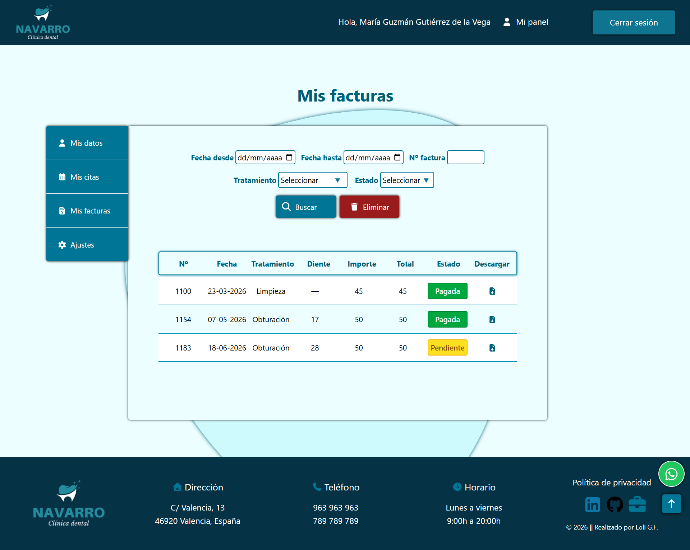
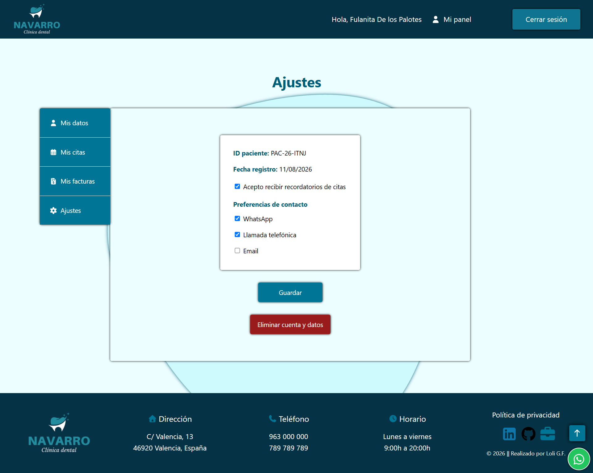

# 🦷 Clínica dental App

Aplicación web para la gestión de citas de una clínica dental. Incluye autenticación, reservas y un dashboard privado para consultar y gestionar los datos de cada paciente.

## 🚀 Demo 

[Proyecto Clínica Dental](https://calendario-dentista-react.pages.dev/)

## 🛠 Tecnologías

- React  
- JavaScript (ES6+)  
- Tailwind CSS  
- Firebase (Firestore)  
- React DatePicker  
- Swiper

## ✨ Funcionalidades

- Reserva de citas con validación de formulario
- Calendario con horarios reales y filtrado dinámico
- Gestión completa de citas (crear, editar, eliminar)
- Persistencia de datos en tiempo real con Firebase
- Filtrado de profesionales según servicio
- Gestión de estados (error, éxito, loading)
- Dashboard privado para pacientes con datos personales, citas, facturas y ajustes de cuenta
- Diseño responsive

## 🧩 Funcionalidad destacada

Sistema de gestión que permite a los usuarios:
- Acceder al dashboard personal tras iniciar sesión
- Reservar citas en tiempo real
- Consultar, modificar o cancelar citas  

### Dashboard del paciente

El dashboard requiere una cuenta iniciada y reúne estas secciones:

- **Mis datos:** consultar, completar y editar la información personal, de contacto y del seguro dental.
- **Mis citas:** consultar las citas ordenadas por fecha, reservar nuevas citas y cambiar la fecha o cancelar una cita existente.
- **Mis facturas:** consultar facturas de ejemplo, filtrarlas por intervalo de fechas, número, tratamiento y estado, y abrir sus archivos PDF.
- **Ajustes:** consultar el ID y la fecha de registro, configurar los recordatorios y las preferencias de contacto, o eliminar la cuenta mediante un flujo de confirmación.

## 🧠 Aprendizajes clave

- Gestión de estado en React  
- Manejo de asincronía con async/await  
- Integración con Firebase (Firestore)  
- Validación de formularios  
- Organización modular de componentes
- Desarrollo asistido por IA: metodología de trabajo definida con AGENTS.md para garantizar buenas prácticas y escalabilidad.

## 📸 Capturas

### Home

### Reservar cita

### Iniciar sesión y crear cuenta de paciente

### Dashboard

#### Mis citas

[Ver demostración de la gestión de citas (CRUD)](https://github.com/loli-digital/calendario-dentista-react/issues/21)

#### Mis datos

#### Mis facturas

#### Ajustes

## Bibliografía

- [React](https://es.react.dev/)
- [Instalación Tailwind en React con Vite](https://tailwindcss.com/docs/installation/using-vite)
- [Swiper](https://swiperjs.com/react)
- [Info React DatePicker](https://reactdatepicker.com/)

## Instalación y ejecución

1. Clonar el repositorio:
`git clone https://github.com/loli-digital/calendario-dentista-react.git`

2. Instalar dependencias
`pnpm install`

3. Ejecutar
`pnpm run dev`